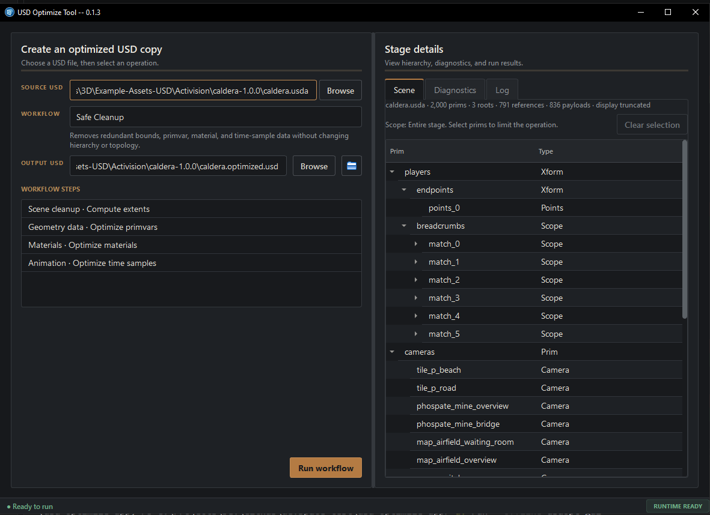

# USD Optimize App

A standalone CLI and GUI for optimizing OpenUSD scenes with NVIDIA's `usd-optimize` runtime.


[](LICENSE)



## Quick Start

1. Download the Windows ZIP from [Releases](https://github.com/Ahmed-Hindy/usd-optimize-app/releases) and extract the folder.
2. Run `usdopt-gui.cmd`.
3. Open a `.usd`, `.usda`, or `.usdc` file, pick a workflow, and click **Run**.

The portable package bundles Python, PySide6, and NVIDIA `usd-optimize` v1.4.0 (OpenUSD 26.08)—nothing else to install.

## Workflows

| Workflow | Preset ID | What it does |
| --- | --- | --- |
| **Safe Cleanup** | `safe_publish` | Recomputes bounds and removes redundant primvars, materials, and duplicate time samples without changing hierarchy or mesh topology. |
| **Geometry Optimization** | `geometry_optimization` | Recomputes bounds and optimizes primvar storage across the stage or selected prims. |
| **Inspect Stage** | `diagnostics` | Collects prim, face, and vertex statistics automatically when a stage is loaded. |
| **Find Overlaps** | `find_overlaps` | Detects intersecting meshes on the CPU without modifying the scene. |

Select prims in the **Scene** tree to optimize only those hierarchies, or clear the selection to run across the entire stage. When scoped to selected prims, **Safe Cleanup** automatically skips material deduplication so materials shared outside the selection aren't affected.

## CLI

From the extracted folder:

```powershell
.\usdopt.cmd optimize --input "C:\path\asset.usda" --preset safe_publish
```

## Documentation

- [User & CLI Guide](docs/gui.md)
- [Operations & Support Reference](docs/operations.md)
- [Development & Packaging Guide](docs/development.md)

## License

Apache-2.0. See [LICENSE](LICENSE).
